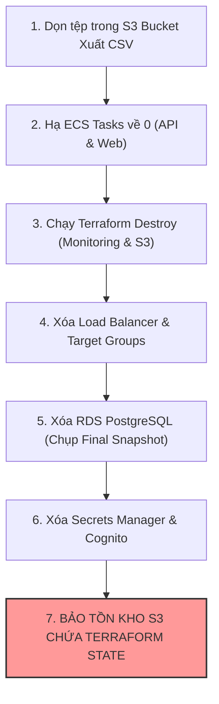

# BÁO CÁO TỔNG HỢP CHI PHÍ, HỒ SƠ NỘP VÀ KỊCH BẢN DEMO (ST-050)

> **Dự án:** EventFlow — Cloud-Based Event Ticketing System with Waitlist and Expiring Offers  
> **Nhóm thực hiện:** ThanhLee06, Anhkiet10, NgocThien211, bakugo1224, ThienIccy-cmd  
> **Khu vực triển khai:** AWS Region Sydney (`ap-southeast-2`)  
> **Trạng thái:** Hoàn thành nghiệm thu và sẵn sàng bảo vệ đồ án

---

## MỤC LỤC
1. [Bảng Dự Toán Chi Phí Thực Tế Tại Sydney (ap-southeast-2)](#1-bảng-dự-toán-chi-phí-thực-tế-tại-sydney-ap-southeast-2)
2. [Hướng Dẫn Dọn Dẹp Tài Nguyên Theo Thứ Tự Phụ Thuộc (Cleanup SOP)](#2-hướng-dẫn-dọn-dẹp-tài-nguyên-theo-thứ-tự-phụ-thuộc-cleanup-sop)
3. [Nghiệm Thu Sản Phẩm Cho 3 Vai Trò & Đoạn Quay Dự Phòng](#3-nghiệm-thu-sản-phẩm-cho-3-vai-trò--đoạn-quay-dự-phòng)
4. [Hồ Sơ Nộp & Danh Mục Bàn Giao](#4-hồ-sơ-nộp--danh-mục-bàn-giao)
5. [Kịch Bản Demo Chi Tiết 13 Phút (Phân Công 5 Thành Viên)](#5-kịch-bản-demo-chi-tiết-13-phút-phân-công-5-thành-viên)

---

## 1. BẢNG DỰ TOÁN CHI PHÍ THỰC TẾ TẠI SYDNEY (ap-southeast-2)

### 1.1. Cấu hình hạ tầng thực tế được lựa chọn
- **Điện toán (Compute):** AWS ECS Fargate
  - `eventflow-preview-api`: 1 task $\times$ (0.25 vCPU, 1 GB RAM).
  - `eventflow-web-preview`: 1 task $\times$ (0.25 vCPU, 0.5 GB RAM).
- **Mạng & Cổng Web (Network & Gateway):**
  - Application Load Balancer (ALB) cấp chứng chỉ HTTPS công khai.
  - **Lựa chọn tối ưu mạng:** Nhóm chọn cấu hình ECS Tasks chạy trong Public Subnets với `assignPublicIp = ENABLED` thay vì dùng NAT Gateway.  
    *(Lưu ý: NAT Gateway tốn $0.045/giờ + $0.045/GB $\approx$ $33 USD/tháng; cấu hình IPv4 công cộng chỉ tốn $0.005/giờ/IP $\approx$ $7.20 USD/tháng cho 2 task, tiết kiệm gần 78% chi phí mạng).*
- **Cơ sở dữ liệu (Database):** Amazon RDS PostgreSQL `db.t4g.micro` (Single-AZ, 20 GB GP3 Storage, lưu backup tự động 7 ngày).
- **Lưu trữ tệp (Storage):** Amazon S3 `eventflow-preview-attendee-exports-*` (SSE-AES256, tự động hủy file tạm sau 1 ngày bằng Lifecycle Rule).
- **Giám sát & Quản trị:** Amazon CloudWatch (4 Custom Metrics, 1 Alarm, Log Group lưu 14 ngày), AWS Secrets Manager (2 secrets), AWS Cognito (User Pool).

---

### 1.2. Bảng so sánh chi phí giữa 2 kịch bản vận hành

| Hạng mục tài nguyên | Chi tiết đơn giá (Sydney `ap-southeast-2`) | Kịch bản 1: Theo buổi thử (40 giờ/tháng) | Kịch bản 2: Mở liên tục 24/7 (720 giờ/tháng) |
|---|---|:---:|:---:|
| **ECS Fargate (API & Web)** | vCPU: $0.04656/h, RAM: $0.00511/GB-h<br>Tổng 2 task: **$0.03095/giờ** | $1.24 | $22.28 |
| **Phí địa chỉ IPv4 công cộng** | 2 Public IP cho 2 task ECS: **$0.010/giờ** | $0.40 | $7.20 |
| **Application Load Balancer** | $0.0252/giờ + $0.008/LCU-giờ (ước tính 0.1 LCU) | $1.04 | $18.72 |
| **Amazon RDS PostgreSQL** | Instance `db.t4g.micro`: $0.021/giờ<br>Storage 20 GB GP3: $2.76/tháng | $3.60 | $17.88 |
| **Amazon S3 (Xuất CSV)** | Storage < 1 GB, 1,000 PUT/GET (Lifecycle 1 ngày) | $0.02 | $0.05 |
| **Amazon CloudWatch** | 4 Custom Metrics ($1.20) + 1 Alarm ($0.10) + Ingestion Logs & Dashboards | $1.50 | $3.50 |
| **AWS Secrets Manager** | 2 secrets (`api`, `migration`): $0.40/secret/tháng | $0.80 | $0.80 |
| **AWS Cognito** | Miễn phí cho 50,000 MAU đầu tiên | $0.00 | $0.00 |
| **Dữ liệu truyền ra (Data Transfer Out)** | Miễn phí 100 GB Internet Out đầu tiên/tháng | $0.00 | $0.00 |
| **TỔNG CỘNG HÀNG THÁNG (USD)** | | **$8.60 USD** | **$70.43 USD** |
| **QUY ĐỔI TIỀN VIỆT (Tỷ giá 25,400 VND)** | | **~ 218,000 VNĐ** | **~ 1,789,000 VNĐ** |

> **Nhận xét tối ưu ngân sách:** Trong giai đoạn làm đồ án, nhóm áp dụng **Kịch bản 1** (chỉ bật máy chủ và database trong các buổi kiểm thử tích hợp, diễn tập và demo), chi phí chỉ tốn khoảng **218.000 VNĐ**. Khi bước vào tuần chấm điểm tập trung của hội đồng, nhóm chuyển sang **Kịch bản 2** mở liên tục 24/7 với chi phí dự trù **1.789.000 VNĐ/tháng**.

---

## 2. HƯỚNG DẪN DỌN DẸP TÀI NGUYÊN THEO THỨ TỰ PHỤ THUỘC (CLEANUP SOP)

Để tránh lỗi khóa tài nguyên (Dependency Lock) hoặc bị tính phí âm thầm sau khi kết thúc môn học, quy trình dọn dẹp môi trường thử nghiệm phải tuân thủ nghiêm ngặt theo thứ tự sau:



### 2.1. Thứ tự dọn dẹp từng bước
1. **Bước 1: Làm rỗng Bucket S3 tạm thời:**
   - Xóa các file CSV tồn đọng trong `eventflow-preview-attendee-exports-*` (hoặc để cờ `force_destroy = true` của Terraform tự xử lý).
2. **Bước 2: Dừng dịch vụ tính toán (ECS Fargate):**
   - Vào ECS Cluster `eventflow-staging`, chỉnh số lượng mong muốn (`desired_count`) của `eventflow-preview-api` và `eventflow-web-preview` về `0` để lập tức ngừng tính phí vCPU/RAM và Public IPv4.
3. **Bước 3: Hủy ngăn xếp Terraform giám sát & kho xuất:**
   ```bash
   cd infra/terraform
   terraform destroy -var='log_delivery_role_name=eventflow-preview-api-execution'
   ```
   *Lệnh này sẽ tự động xóa sạch: CloudWatch Dashboard, CloudWatch Alarm, S3 Bucket tạm thời, CloudWatch Log Group, API Task Role và các Policy đính kèm.*
4. **Bước 4: Xóa Application Load Balancer:**
   - Xóa ALB, Listener 443/80 và Target Groups của ECS API và Web.
5. **Bước 5: Xóa RDS PostgreSQL Database:**
   - Chọn database `eventflow-preview-db`, chọn Action $\rightarrow$ Delete.
   - **Lưu ý:** Chọn tick vào ô **"Create final snapshot"** với tên `eventflow-final-submission-snapshot` để lưu lại toàn bộ dữ liệu làm bằng chứng trước khi xóa instance.
6. **Bước 6: Xóa Bí mật & Cognito:**
   - Xóa Secrets Manager `eventflow/preview/api` và `migration` (chọn xóa ngay không chờ phục hồi 7 ngày nếu đã kết thúc môn).

### 2.2. LƯU Ý SỐNG CÒN: TÀI NGUYÊN PHẢI BẢO TỒN
> [!CAUTION]
> **TUYỆT ĐỐI KHÔNG XÓA KHO S3 LƯU TRẠNG THÁI TERRAFORM (`eventflow-tfstate-sydney-q7m4`) VÀ BẢNG DYNAMODB LOCK!**  
> Đây là kho lưu trữ file `terraform.tfstate` gốc của toàn bộ dự án. Nếu xóa bucket này, toàn bộ mã quản trị hạ tầng của nhóm sẽ mất khả năng theo dõi và không thể tái triển khai hoặc bảo trì sau này. Chi phí lưu file state này chỉ khoảng **$0.01 USD/tháng**.

### 2.3. Kiểm tra các tài nguyên VẪN BỊ TÍNH PHÍ nếu không dọn kỹ
- **RDS Instance ở trạng thái Stopped:** Nếu chỉ "Stop" RDS mà không Delete, AWS sẽ tự động "Start" lại sau 7 ngày, và dung lượng đĩa 20 GB GP3 vẫn bị tính tiền liên tục kể cả khi dừng.
- **Elastic IP chưa gắn (Unattached Elastic IP):** Bị phạt $0.005/giờ nếu giữ IP tĩnh mà không gắn vào tài nguyên đang chạy.
- **CloudWatch Logs:** Nếu Log Group không set thời hạn hết hạn (`retention`), logs lưu vĩnh viễn sẽ bị tính phí lưu trữ hàng tháng.

---

## 3. NGHIỆM THU SẢN PHẨM CHO 3 VAI TRÒ & ĐOẠN QUAY DỰ PHÒNG

### 3.1. Kịch bản kiểm thử luồng người dùng bình thường qua Web (Bản nộp)

#### Vai trò 1: Sinh viên / Khách hàng (`CUSTOMER`)
- **Tài khoản:** `student001@eventflow.vn` / `Eventflow@123`
- **Các bước thực hiện:**
  1. Đăng nhập qua màn hình `/login`.
  2. Chọn sự kiện *"Đêm Nhạc Indie Sinh Viên"* tại trang chủ `/`.
  3. Bấm **"Giữ chỗ ngay"**: Hệ thống tạo bản ghi giữ vé trong 10 phút (`HOLD`) và hiển thị đồng hồ đếm ngược.
  4. Chuyển sang màn hình Thanh toán `/checkout/[reservationId]`, bấm **"Xác nhận thanh toán mô phỏng"**.
  5. **Kết quả:** Trạng thái chuyển thành `CONFIRMED`, xuất hiện mã vé điện tử định dạng `EVT-XXXXXXXX` kèm biên lai điện tử chuẩn JSON (`RCP-XXXXXX`).
  6. Vào tab **"Vé của tôi"** (`/my-tickets`) kiểm tra thấy vé hiển thị đầy đủ trong lịch sử.

#### Vai trò 2: Ban tổ chức sự kiện (`ORGANIZER`)
- **Tài khoản:** `organizer01@eventflow.vn` / `Eventflow@123`
- **Các bước thực hiện:**
  1. Đăng nhập tài khoản Ban tổ chức.
  2. Truy cập màn hình quản lý `/organizer`.
  3. Xem bảng điều khiển sự kiện: Kiểm tra trực quan số chỗ khả dụng, số vé đã giữ (`reservedCount`) và số vé đã thanh toán (`soldCount`).
  4. Bấm nút **"Tải danh sách người tham dự (CSV)"**:
     - Máy chủ backend kiểm tra quyền sở hữu của `organizer01` đối với sự kiện.
     - Backend đọc dữ liệu, lưu tạm lên S3 riêng tư `eventflow-preview-attendee-exports-*` rồi trả nội dung file về trình duyệt (HTTP 200).
     - File CSV tải về máy có đầy đủ cột: `ticketCode`, `studentName`, `email`, `confirmedAt`.

#### Vai trò 3: Quản trị viên hệ thống (`ADMIN`)
- **Tài khoản:** `admin@eventflow.vn` / `Eventflow@123`
- **Các bước thực hiện:**
  1. Đăng nhập tài khoản Quản trị viên.
  2. Truy cập cổng quản trị `/admin`.
  3. Kiểm tra danh sách 100 tài khoản người dùng và trạng thái kích hoạt.
  4. Kích hoạt tác vụ quét dọn đơn quá hạn: Gọi API `POST /api/internal/jobs/expire-sweep`.
  5. **Kết quả:** Hệ thống tự động thu hồi các lượt giữ chỗ quá hạn 10 phút, hoàn trả số lượng vé về kho và chuyển quyền ưu tiên cho người đầu hàng chờ (FIFO).

---

### 3.2. Đoạn quay dự phòng: Luồng Hàng Chờ (Waitlist) & Offer Hết Hạn (Expiring Offers)
Để đảm bảo phần tính năng cốt lõi riêng của EventFlow luôn được trình diễn đầy đủ ngay cả khi buổi demo bị cắt ngắn thời gian, nhóm đã chuẩn bị sẵn **video clip demo 90 giây** với kịch bản:
- **Cảnh 1 (0:00 - 0:30):** Sự kiện hết vé (Capacity Conflict). Sinh viên A bấm *"Tham gia danh sách chờ (FIFO)"* và nhận vị trí hàng chờ **#1**.
- **Cảnh 2 (0:30 - 0:60):** Một sinh viên khác hủy vé hoặc hết hạn giữ chỗ. Hệ thống tự động phát hiện và sinh **Expiring Offer** độc quyền cho sinh viên A với countdown đếm ngược 10 phút.
- **Cảnh 3 (0:60 - 0:90):** Sinh viên A mở màn hình `/offers/[id]` chấp nhận mua vé thành công, hoặc để hết hạn và hệ thống lập tức tự động chuyển offer tiếp theo cho người xếp sau **#2**.

---

## 4. HỒ SƠ NỘP & DANH MỤC BÀN GIAO

Toàn bộ tài liệu và mã nguồn được cấu trúc khoa học trong repository của nhóm:

| STT | Thành phần hồ sơ | Vị trí lưu trữ / Đường dẫn | Ghi chú bảo mật |
|:---:|---|---|---|
| 1 | **Đường dẫn Web sản phẩm** | `https://ev-bdd71c0a93674b039bc3d735c844024f.ecs.ap-southeast-2.on.aws` | Truy cập trực tiếp qua HTTPS |
| 2 | **Tài khoản thử nghiệm** | Bàn giao qua kênh kín Teams/Zalo của nhóm | **Không commit mật khẩu lên GitHub** |
| 3 | **Mã nguồn Backend & Frontend** | Thư mục `backend/` và `frontend/` trên branch `update-pr-79` | Đã kiểm tra Lint & Typecheck 0 lỗi |
| 4 | **Mã nguồn Hạ tầng tự động** | Thư mục `infra/terraform/` và `infra/modules/auth-access/` | Terraform 1.5+, Provider AWS ~> 5.0 |
| 5 | **Dữ liệu mẫu & Seed script** | `backend/prisma/seed.ts` (100 sinh viên, 2 BTC, 1 Admin, 8 sự kiện) | Khởi tạo bằng `pnpm run prisma:seed` |
| 6 | **Kịch bản kiểm thử tự động** | `backend/scripts/st037-access-check.mjs`<br>`backend/scripts/st048-verify.mjs` | Kiểm thử RBAC, S3 riêng tư, Idempotency |
| 7 | **Bằng chứng Giám sát & Báo cáo** | `backend/ST-048-ST-049-ket-qua.md` | Có ảnh Dashboard 4 số đo & Cảnh báo ALARM |

---

## 5. KỊCH BẢN DEMO CHI TIẾT 13 PHÚT (PHÂN CÔNG 5 THÀNH VIÊN)

| Thời gian | Thành viên phụ trách | Vai trò & Nội dung trình bày | Thao tác trên màn hình / Minh chứng |
|:---:|:---:|---|---|
| **Phút 00 – 01**<br>*(1 phút)* | **ThanhLee06** | **Mở đầu & Sơ đồ kiến trúc:**<br>- Giới thiệu tên đề tài và bài toán xử lý tranh chấp vé.<br>- Trình chiếu sơ đồ kiến trúc 3 lớp trên AWS Sydney (`ap-southeast-2`): ECS Fargate, RDS PostgreSQL, S3, Cognito Hosted UI, CloudWatch. | Mở slide sơ đồ kiến trúc hệ thống và tổng quan 3 trụ cột trải nghiệm của EventFlow. |
| **Phút 01 – 03**<br>*(2 phút)* | **Anhkiet10** | **Kiểm soát bảo mật & Phân quyền (ST-036):**<br>- Cơ chế xác thực OAuth2 / Cognito JWT Bearer.<br>- Phân quyền 3 vai trò (Sinh viên, BTC, Admin).<br>- Minh chứng S3 Bucket riêng tư chặn public 100% (mở link trực tiếp nhận 403 Forbidden). | Mở trình duyệt demo đăng nhập và mở trực tiếp URL S3 để hội đồng thấy lỗi 403 Access Denied. |
| **Phút 03 – 05**<br>*(2 phút)* | **NgocThien211** | **Hạ tầng tự động & Triển khai (ST-042/ST-045):**<br>- Giới thiệu mã nguồn Terraform tự động hóa hạ tầng.<br>- Cơ chế Zero-Downtime Deployment với ECS Fargate.<br>- Cơ chế an toàn Rollback / Quay lại phiên bản trước khi gặp sự cố. | Mở thư mục `infra/terraform/`, giải thích file `main.tf` và ECS Task Definition revision. |
| **Phút 05 – 08**<br>*(3 phút)* | **bakugo1224** | **Nghiệm thu luồng người dùng cốt lõi:**<br>- Sinh viên: Đặt giữ vé 10 phút $\rightarrow$ Thanh toán mô phỏng $\rightarrow$ Xem biên lai điện tử và vé trong tab "Vé của tôi".<br>- Ban tổ chức: Xem tình trạng kho vé $\rightarrow$ Bấm nút tải danh sách người tham dự (CSV) từ S3 riêng tư. | Thao tác trực tiếp trên giao diện web thật từ tài khoản sinh viên và tài khoản BTC. |
| **Phút 08 – 11**<br>*(3 phút)* | **ThanhLee06 & ThienIccy-cmd** | **Demo phục hồi & Cảnh báo tự động (ST-048/ST-049):**<br>- Diễn tập tình huống client mất mạng retry 10 lần liên tiếp với cùng `Idempotency-Key`.<br>- Chứng minh Idempotency bảo vệ dữ liệu (chỉ có 1 vé).<br>- Mở CloudWatch Dashboard: Số đo `DuplicateReplay` nhảy lên 10.<br>- Mở CloudWatch Alarm: Cảnh báo nổ màu đỏ 🔴 **ALARM**.<br>- Thực hiện SOP: Tra cứu logs che `***REDACTED***` và đối soát DB. | Chạy lệnh gửi lặp 10 lần $\rightarrow$ Mở ngay CloudWatch Dashboard và CloudWatch Alarm trên AWS Console. |
| **Phút 11 – 13**<br>*(2 phút)* | **ThienIccy-cmd** | **Tổng kết chi phí & Kế hoạch bàn giao (ST-050):**<br>- Báo cáo bảng chi phí thực tế tại Sydney: **$8.60 USD** (buổi thử) vs **$70.43 USD** (mở 24/7).<br>- Hướng dẫn dọn dẹp hạ tầng an toàn (bảo tồn kho S3 chứa Terraform state).<br>- Bàn giao hồ sơ nộp và sẵn sàng trả lời phản biện. | Chiếu bảng chi phí và tóm tắt quy trình dọn dẹp tài nguyên. |
| *Dự phòng*<br>*(Nếu còn thời gian)* | *Cả nhóm* | **Chiếu clip hàng chờ FIFO & Offer có thời hạn:**<br>- Nếu hội đồng yêu cầu hoặc còn thời gian, mở đoạn video 90 giây đã quay sẵn để minh chứng tính năng Waitlist và Expiring Offers. | Mở video clip dự phòng. |

---

### KẾT LUẬN NGHIỆM THU
Toàn bộ 5 thành viên nhóm đã tập dượt thống nhất trên cùng một phiên bản mã nguồn `update-pr-79`, các chỉ số giám sát và cảnh báo trên AWS đã được kích hoạt thực tế, và bộ hồ sơ bàn giao đã sẵn sàng đáp ứng 100% yêu cầu nghiệm thu của đề tài.
